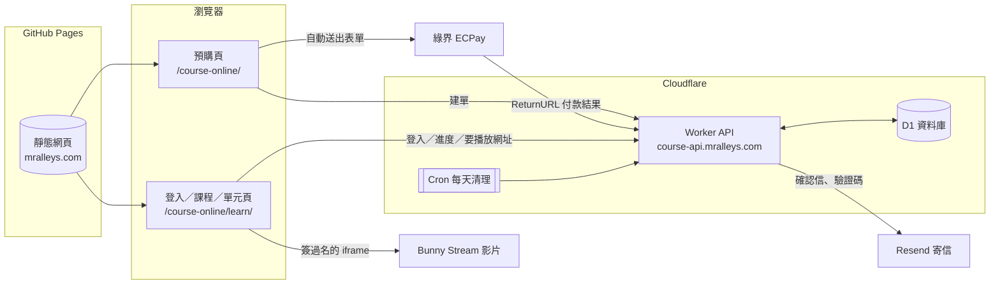
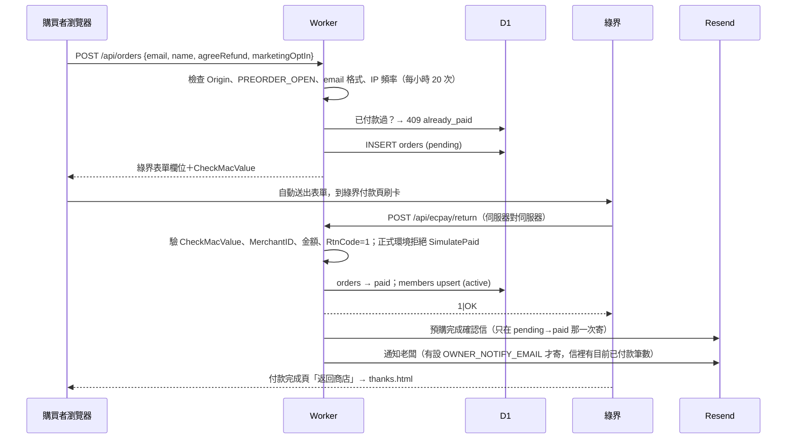
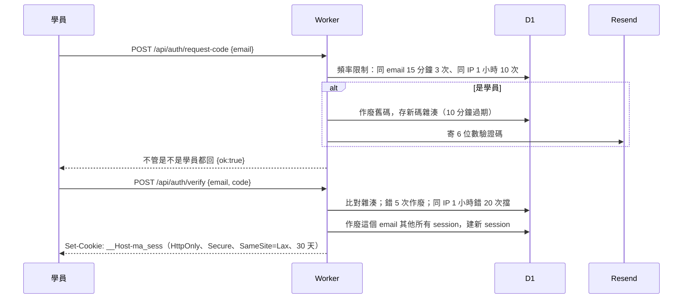

# 線上寫歌課・系統架構

> 這份文件說明「線上寫歌課・第一期」的預購、付款、登入與看課系統怎麼運作，以及正式上線前老闆要自己設定的東西。
> 程式在 `worker/`（API）與 `course-online/`（網頁）。本機怎麼跑、怎麼測，見 [README.md](README.md)。

## 0a. 2026-11-09 晚上線更新（優先於 0 節）

- API 放在 `https://mralleys-course-api.mralleys.workers.dev`（不搬 mralleys.com 的 DNS）；登入 token 改成 localStorage＋`X-MA-Session` header（跨站 cookie 會被 Safari 擋）。
- 哪集免費改成後台勾選（`episodes.free`，migration 0003）；調順序不會再自動換免費集。
- 單元標題、介紹、練習、檢查點後台可以改（`unit_overrides`），沒改過用 `src/course.js` 的預設；預購頁的四個單元文字也會跟著後台。
- 試看開關、鎖住的集要不要顯示標題：後台「網站開關」（`settings` 表），沒存過照 wrangler.toml 的 `FREE_EPISODES_OPEN`／`SHOW_LOCKED_TITLES`。預購期間預設不開放試看。
- 後台一次存：`POST /api/admin/save`（單元文字、集數照畫面順序、刪除、開關，全部驗過才在同一個 batch 寫入）。

## 0. 2026-11-09 MVP 更新（這節優先於下面的舊內容）

下面第 2–8 節是 scaffold 時寫的，其中 **Bunny Stream、Resend、浮水印、`course.js` 裡的 bunnyId** 已經換掉，以這節為準：

| 項目 | 現在的做法 | 程式 |
| --- | --- | --- |
| 影片 | YouTube 不公開影片，`youtube-nocookie.com` 嵌入站內播。影片 ID 只有 `/api/video` 確認看得到才回，`/api/course` 不帶 | `src/video.js`、`src/index.js` videoUrl |
| 集數 | D1 `episodes` 表；後台 `/course-online/admin/` 新增、改標題、貼 YouTube 連結、上下移、發布／隱藏、刪除 | `migrations/0002`、`src/episodes.js` |
| 免費集 | 每個單元「排第一個、已發布」的那集，不存欄位、每次算；調順序免費集會跟著換 | `markFree` |
| 付費解鎖 | 一次購買（`PREORDER_PRICE`，現在 NT$2,480）解鎖全部集數；沿用綠界建單＋ReturnURL | `createOrder`、`ecpayReturn` |
| 鎖住的集數 | 對外只顯示「第 N 集」＋長度，不顯示標題（11/6 定：對外不寫做法）；`SHOW_LOCKED_TITLES=true` 可打開 | `publicCourse` |
| 交作業 | 單元頁表單：文字（5,000 字內）＋一個檔案（20 MB 內，錄音／影片／圖片／PDF／文件）。文字進 D1 `homework`，檔案進 KV `HOMEWORK_FILES` | `src/homework.js`、`submitHomework` |
| 作業通知 | 交了馬上寄信到 `HOMEWORK_NOTIFY_EMAIL`（沒設用 `OWNER_NOTIFY_EMAIL`）；寄失敗學員照樣成功，原因記在 `notify_error`，後台看得到 | `homeworkNotifyEmail` |
| 寄信 | `EMAIL_PROVIDER=gmail`（Gmail API：refresh token → `users.messages.send`）或 `resend`；`EMAIL_MODE=log`／`dry-run` 只印不寄（正式環境不准） | `src/email.js` |
| 後台 | 靜態頁 `/course-online/admin/`，輸入 `ADMIN_TOKEN`（只存在該分頁），API 用 `Authorization: Bearer` | `adminRoute` |
| live | 規則待定（每單元一堂 or 每月兩堂）。只留 `LIVE_RULE` 設定值，`/api/course` 帶 `live.rule`，沒有任何解鎖邏輯 | — |
| 開放時機 | `COURSE_OPEN`：付費集開放；`FREE_EPISODES_OPEN`：免費集要不要比開課早放（空白＝跟 COURSE_OPEN 一樣）；`PREVIEW_EMAILS`：開課前先看全部 | `freeOpen`、`canWatch` |

集數資料**不進 git**（repo 公開，YouTube 不公開影片的 ID 會外流）：`worker/seed/episodes.json` 只有標題與長度，`worker/scripts/seed-episodes.mjs` 從 repo 外的 `yt-uploads.json` 補 ID，產出 `*.local.sql`（已 gitignore）再 `wrangler d1 execute --file`。

已知限制：YouTube 嵌入播放器右下角有 YouTube 標誌，點了會開 YouTube（嵌入的標準行為，關不掉）；拿到影片 ID 的人可以直接在 YouTube 看，這是不公開影片本來的性質。

## 1. 產品設定（程式與文案都照這份走）

| 項目 | 定案 |
| --- | --- |
| 對象 | 完全沒寫過歌的人 |
| 內容 | 一對一寫歌課的第一期（冰山理論／文字運鏡、動作與具體物件／韻腳、朗讀即旋律、動機與點譜法），約 160 分鐘預錄影片，分 4 個單元，每單元有練習與檢查點 |
| 承諾 | 「寫出你的第一段詞、錄下你哼的第一段旋律」（不承諾「寫出人生第一首歌」） |
| 價格 | NT$2,480（優惠碼折 NT$200，限動發放；優惠碼功能待做）。價格在 `worker/wrangler.toml` 的 `PREORDER_PRICE`（兩個環境）與 `worker/src/index.js` 的預設值，預購頁、總覽頁、首頁課卡的文字要一起改 |
| 配套 | 可以交作業、幫學員看 demo，等於送一次免費諮詢。學員在單元頁交（文字＋一個檔案），即時寄信通知我們；交幾次待定（目前每人每天最多 20 次，只擋誤觸） |
| 對外文案 | 單元名稱與說明只寫概念與學完的收穫，不寫做法（2026-11-06 耗耗定案）；上面「內容」欄是內部用的完整版 |
| 開課門檻 | 預購滿 5 筆付款才製作上線 |
| 退款 | 未開課，或延期超過約定日（目前寫 2027 年 1 月 31 日）：全額退款 |
| 上線時間 | 「預計 2027 年 1 月上線（以實際公告為準）」 |
| 帳號 | 沒有密碼。email ＋ 6 位數驗證碼登入（同一時間一台裝置的邏輯還在，對外不寫） |
| 影片 | YouTube 不公開影片，嵌在站內播；每個單元的第一集免費（不用登入），其他集購買後解鎖。浮水印邏輯留著但預設關（`WATERMARK`），對外文案不寫浮水印、防分享 |
| 名單 | 購買者 email 可匯出 CSV 當作通知名單（有勾選是否願意收活動消息） |
| 規模 | 幾十位學員 |

## 2. 整體架構



純文字版：

```
瀏覽器 ──(靜態頁)── GitHub Pages：mralleys.com/course-online/
   │
   ├─ fetch（帶 cookie）──> Cloudflare Worker：course-api.mralleys.com ──> D1
   │                              │  └─> Resend（寄信）
   ├─ 表單 POST ──> 綠界付款頁      │
   │                綠界 ──(ReturnURL，伺服器對伺服器)──┘
   └─ iframe ──> Bunny Stream（網址帶 token＋期限，由 Worker 簽）
```

- 網頁是純靜態檔，跟主站一起放 GitHub Pages，不需要另外的主機。
- 所有需要資料庫或金鑰的事情都在 Worker 裡做；網頁裡沒有任何金鑰。
- `mralleys.com` 和 `course-api.mralleys.com` 是同一個網站（same-site），所以 cookie 可以用 `SameSite=Lax`。

## 3. 資料模型（D1，`worker/migrations/0001_init.sql`）

時間欄位一律存 epoch 毫秒，匯出時換成台灣時間。

| 資料表 | 用途 | 重點欄位 |
| --- | --- | --- |
| `orders` | 每次按「前往付款」就建一筆 | `merchant_trade_no`（主鍵，送給綠界）、`email`、`amount`、`status`（pending／paid／failed／refunded）、`simulate_paid`、`raw_callback` |
| `members` | 付款成功的人；帳號就是 email | `email`（主鍵）、`access`（active／revoked）、`marketing_opt_in`、`first_paid_at` |
| `login_codes` | 登入驗證碼，只存雜湊 | `code_hash`、`expires_at`（10 分鐘）、`attempts`（最多 5 次）、`consumed_at` |
| `sessions` | 登入狀態，只存 token 雜湊 | `token_hash`、`email`、`expires_at`（30 天，有用就延長）、`revoked_at`、`revoked_reason`（replaced／logout／admin） |
| `rate_events` | 頻率限制的事件紀錄 | `bucket`（例：`code:email:a@b.com`）、`created_at`；cron 每天刪掉一天前的 |
| `progress` | 單元檢查點有沒有勾 | `(email, unit_id)`、`completed_at` |

課程結構（單元、影片、練習、檢查點）不放資料庫，寫在 `worker/src/course.js`，前端從 `/api/course` 讀。影片上傳到 Bunny 後，把 Video ID 填進對應的 `bunnyId`，重新部署就好。

## 4. 請求流程

### 4.1 預購 → 綠界 → 回呼 → 開通 → 寄信



- 付款成功與否**只看 ReturnURL**，不看使用者回到 `thanks.html`。感謝頁只說「付款成功的話會收到信」。
- 綠界會重送 ReturnURL；已經是 paid 的訂單直接回 `1|OK`，不會重複寄信。
- 失敗（刷卡失敗、金額不符、正式環境的模擬付款）會把訂單標成 failed，並記下原因。

### 4.2 登入（驗證碼）



### 4.3 單一裝置

- 新登入成功時，同一個 email 其他還有效的 session 全部標成 `revoked_reason = 'replaced'`。
- 單元頁每 60 秒（以及切回分頁時）呼叫 `/api/session`。回 401 且原因是 `replaced`，就移除播放器並顯示「你的帳號在另一台裝置登入了」。
- 舊裝置手上就算還有沒過期的影片網址，最多也只能再用到網址期限（預設 1 小時）。

### 4.4 浮水印

- `/api/video` 回傳播放網址時一併回傳 `watermark`（登入者 email）。
- 單元頁在 iframe 上方疊一層 `pointer-events: none` 的半透明文字（3 處，每 15 秒換位置）。
- iframe 不給 `allowfullscreen`；全螢幕用頁面自己的按鈕放大整個框，浮水印才會跟著。
- 如果有人用開發者工具刪掉或隱藏浮水印，頁面會把影片一起拿掉。
- 這是「嚇阻」不是「防護」：會寫程式的人還是能繞過，錄螢幕也擋不住。浮水印的用途是讓外流的影片能追到是誰的帳號。

### 4.5 簽名影片網址（Bunny Stream）

```
GET /api/video?id=u1v2   （要有效 session，且 COURSE_OPEN=true 或 email 在 PREVIEW_EMAILS）
→ token = SHA256_HEX(BUNNY_TOKEN_KEY + videoId + expires)
→ https://player.mediadelivery.net/embed/{library}/{videoId}?token=…&expires=…
```

- Bunny 後台要打開 Embed view token authentication，並把 Allowed domains 設成 `mralleys.com`。
- 前端拿不到 Bunny 的 Video ID（`/api/course` 會拿掉 `bunnyId`），只能透過 `/api/video` 簽。
- 之後想換 Cloudflare Stream，只要改 `worker/src/video.js`，回傳同樣格式即可。

### 4.6 名單匯出

```
curl -H "Authorization: Bearer $ADMIN_TOKEN" "https://course-api.mralleys.com/api/admin/export.csv?type=members" -o members.csv
curl -H "Authorization: Bearer $ADMIN_TOKEN" "https://course-api.mralleys.com/api/admin/export.csv?type=orders"  -o orders.csv
```

CSV 開頭有 BOM（Excel 打開中文不亂碼），會擋公式注入。寄活動消息時，只寄給 `marketing_opt_in = 1` 的人；`0` 的人只能收跟這門課有關的通知（例如上線通知、退款）。

## 5. 安全重點

| 項目 | 做法 | 位置 |
| --- | --- | --- |
| 綠界回呼驗證 | 驗 CheckMacValue（SHA256，官方測試向量有測）、MerchantID、金額、RtnCode；用固定時間比較 | `worker/src/ecpay.js`、`index.js#ecpayReturn` |
| 金鑰沒設 | `ECPAY_HASH_KEY`／`ECPAY_HASH_IV` 沒設時，建單與回呼都回 503，避免有人用空金鑰偽造付款 | `index.js#ecpayConfigured` |
| 模擬付款 | 綠界後台的「模擬付款」在正式環境不開通 | `index.js#ecpayReturn` |
| 驗證碼 | 10 分鐘過期、一組最多試 5 次、用過即失效、新碼一發舊碼作廢；資料庫只存 `SHA256(pepper:email:code)` | `worker/src/auth.js` |
| 頻率限制 | 要碼：同 email 15 分鐘 3 次、同 IP 1 小時 10 次；驗碼錯誤：同 IP 1 小時 20 次；建單：同 IP 1 小時 20 次 | `auth.js`、`index.js#createOrder` |
| 不洩漏誰買過 | 要驗證碼時，學員與非學員回一樣的訊息 | `index.js#requestCode` |
| Session | 32 bytes 亂數 token，資料庫只存雜湊；`__Host-` cookie、HttpOnly、Secure；新登入作廢舊 session；登出作廢 | `auth.js` |
| CSRF | 所有 POST（綠界回呼除外）都要 `Origin` 在 `ALLOWED_ORIGINS` 裡；CORS 只對自己網站開 | `index.js#originOk` |
| 管理 API | `ADMIN_TOKEN` 至少 24 字，否則匯出直接關閉；固定時間比較 | `index.js#adminExport` |
| 金鑰管理 | repo 裡沒有任何正式金鑰；只有綠界公開的測試特店金鑰（stage 用）與本機假值 | `wrangler.toml`、`.dev.vars.example` |

已知限制（以幾十位學員的規模可以接受）：

- 要驗證碼時，學員的請求要等寄信完成才回應，非學員馬上回應，理論上可以從回應時間猜出某個 email 有沒有買過。
- 頻率限制以 D1 計數，同時大量請求時可能多放行幾次。
- 浮水印與單一裝置都是嚇阻，不能完全防止錄螢幕外流。

## 6. 每月大概費用（全部請再確認）

以「幾十位學員、3 小時影片」估算。以下價格是撰寫時的印象值，**請再確認**各家官網最新價格。

| 服務 | 用量估計 | 大約費用 |
| --- | --- | --- |
| Cloudflare Workers | 每天遠低於 10 萬次請求 | 免費方案應該夠（付費方案約 US$5／月起，請再確認） |
| Cloudflare D1 | 資料量幾 MB | 免費額度內（請再確認） |
| Bunny Stream 儲存 | 3 小時影片多種畫質，約 5–10 GB | 約 US$0.1／月以內（請再確認） |
| Bunny Stream 流量 | 50 人 × 每人看完一次約 3–5 GB ≈ 150–250 GB | 約 US$2–8／月，依地區單價而定；Bunny 有每月最低消費約 US$1（請再確認） |
| Resend 寄信 | 每月幾百封以內 | 免費方案（約每月 3,000 封、每天 100 封，請再確認）；需要自己的網域 |
| 綠界信用卡手續費 | 每筆 NT$2,480 | 約 2–3%，一筆約 NT$50–75（依簽約費率，請再確認） |
| 網域 | 已有 mralleys.com | 不另外增加 |

合計：除了綠界手續費，每月大約 US$0–10（請再確認）。

## 7. 老闆要自己設定的東西

1. **綠界 ECPay 特店**
   - 申請正式特店，拿到 MerchantID、HashKey、HashIV。
   - 確認信用卡收款已開通；ReturnURL 是程式自動帶的 `https://course-api.mralleys.com/api/ecpay/return`，綠界後台通常不用另外填，但如果特店有「允許的回傳網址」或 IP 白名單設定，要把這個網址加進去（請再確認）。
2. **Cloudflare 帳號**
   - 把 `mralleys.com` 的 DNS 搬到 Cloudflare（或至少讓 Cloudflare 能管 `course-api.mralleys.com`）。GitHub Pages 的主站記錄照原樣保留。
   - 建 D1 資料庫：`npx wrangler d1 create mralleys-course`，把 id 貼進 `worker/wrangler.toml`（兩處）。
   - 部署時 `custom_domain = true` 會自動建立 `course-api.mralleys.com`。
3. **寄信（Resend 或同類服務）**
   - 註冊、驗證寄件網域（例如 `mralleys.com` 或子網域 `mail.mralleys.com`），把它給的 SPF／DKIM DNS 記錄加到 Cloudflare。
   - 建 API key，填 `EMAIL_FROM`（例：`巷弄故事館 <course@mralleys.com>`）。
4. **Bunny Stream**
   - 建一個 Video Library，打開 Embed view token authentication，Allowed domains 填 `mralleys.com`。
   - 記下 Library ID 和 Token Authentication Key；上傳影片後把每支的 Video ID 填進 `worker/src/course.js`。
5. **Worker 金鑰（用 secret，不進 git）**
   ```
   cd worker
   npx wrangler secret put ECPAY_HASH_KEY --env production
   npx wrangler secret put ECPAY_HASH_IV --env production
   npx wrangler secret put CODE_PEPPER --env production      # openssl rand -hex 32
   npx wrangler secret put ADMIN_TOKEN --env production      # openssl rand -hex 24
   npx wrangler secret put RESEND_API_KEY --env production
   npx wrangler secret put BUNNY_TOKEN_KEY --env production
   ```

## 8. 上線清單

**A. 開放預購**

1. 決定並確認文案：退款期限日（目前 2027 年 1 月 31 日）、上線時間文字，以及 `index.html` 裡所有標成「待定」（`.crs-tbd`）的地方：預購截止日、上線前自行取消、上線後幾天內可退與條件、觀看期限、影片外流的處理。全部換成正式文字才能開放預購（`grep -n 'class="crs-tbd"' course-online/index.html` 應該沒有結果）。
2. 完成第 7 節的綠界、Cloudflare、Resend 設定（Bunny 可以晚點）。
3. 填好 `wrangler.toml` 的 `[env.production]`：`ECPAY_MERCHANT_ID`、`database_id`、`EMAIL_FROM`、`OWNER_NOTIFY_EMAIL`（建議填自己的信箱）。
4. 設好所有 secret（第 7 節第 5 點）。
5. `npm test` 全過，`npm run deploy:dry` 沒有錯誤。
6. 套資料庫：`npx wrangler d1 migrations apply mralleys-course --remote --env production`。
7. 部署：`npx wrangler deploy --env production`，確認 `https://course-api.mralleys.com/api/health` 回 `{"ok":true}`。
8. 先用綠界測試環境（stage）走一次完整流程；再用正式環境自己刷一筆真的，確認收到確認信、CSV 裡有這筆，然後從綠界後台退款，並把自己的 `members.access` 改成 `revoked`（見 README「退款」）。
9. 拿掉 `course-online/` 頁面上的 `noindex`，在主站放入口，開始宣傳。

**B. 滿 5 筆之後**

10. 確認已付款筆數 ≥ 5（老闆通知信或 `type=orders` 的 CSV，`simulate_paid = 1` 的不算）。
11. 錄製並上傳影片到 Bunny，把 Video ID 填進 `course.js`，部署。
12. 把自己的 email 放進 `PREVIEW_EMAILS`，部署後登入檢查每支影片、浮水印、單一裝置、進度勾選。
13. 把 `COURSE_OPEN` 改成 `"true"`、確認 `PREORDER_PRICE`（目前 2480）上線後要不要調整（預購頁文案也要一起改），部署。
14. 用 `type=members` 的 CSV 寄上線通知信給所有學員。

**C. 如果沒有達到 5 筆，或延期超過約定日**

15. 寄信說明，從綠界後台逐筆全額退款，並把訂單與學員標成 refunded／revoked。
